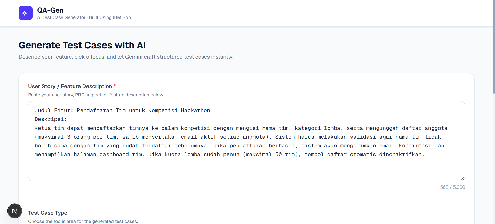
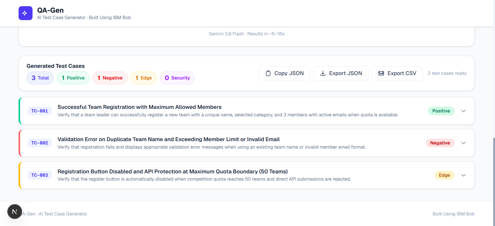

# QA-Gen — AI Test Case Generator

> Generate structured, production-ready test cases from user stories and PRDs in seconds — powered by Google Gemini AI.

---

## Overview

QA-Gen is a full-stack web application that turns plain-English feature descriptions into detailed, structured test cases. Paste a user story or PRD snippet, choose your test focus and quantity, and the app calls the Google Gemini API to return a clean, actionable set of test cases — complete with pre-conditions, step-by-step test steps, and expected results. Results can be exported as JSON or CSV for direct import into tools like Jira and TestRail.

---

## Features

- **AI-powered generation** — Uses the Google Gemini 3.6 Flash model via a secure server-side API route
- **Four test case modes**
  - All / Comprehensive (positive, negative, edge cases, security)
  - Positive & Negative Scenarios
  - Edge Cases
  - Security & Validation
- **Configurable quantity** — Generate 3, 5, 10, 15, or any custom number of test cases (up to 20)
- **Accordion result cards** — Each test case expands to reveal the full breakdown: scenario, pre-conditions, steps, and expected result
- **Color-coded type badges** — Positive (green), Negative (red), Edge (amber), Security (purple)
- **Export options** — Copy JSON to clipboard, download as `.json`, or download as `.csv`
- **Stats bar** — Live count of results by test type
- **Fully responsive layout** — Fluid from mobile up to 1440 px; input and results sit side-by-side on large screens

---

## Tech Stack

| Layer | Technology |
|---|---|
| Framework | [Next.js 16](https://nextjs.org/) (App Router) |
| Language | JavaScript / JSX (no TypeScript) |
| Styling | [Tailwind CSS v4](https://tailwindcss.com/) |
| AI | [Google Gemini API](https://ai.google.dev/) via `@google/generative-ai` |
| Font | Geist Sans / Geist Mono (Next.js Google Fonts) |

---

## Project Structure

```
src/
├── app/
│   ├── globals.css                   # Global styles and Tailwind import
│   ├── layout.js                     # Root layout with metadata
│   ├── page.js                       # Main dashboard page (client component)
│   └── api/
│       └── generate-tests/
│           └── route.js              # Gemini API route (server-side)
└── components/
    ├── Header.jsx                    # Sticky branded header
    ├── UserStoryInput.jsx            # Textarea input with char counter + validation
    ├── TestCaseTypeSelector.jsx      # 4-option visual card selector
    ├── NumberSelector.jsx            # Preset buttons + custom number input
    ├── ResultsTable.jsx              # Accordion test case cards
    ├── ExportButtons.jsx             # Copy JSON / Export JSON / Export CSV
    └── ErrorAlert.jsx                # Dismissible error banner
```

---

## Prerequisites

- **Node.js** v18 or higher — [Download](https://nodejs.org/)
- **npm** v9 or higher (bundled with Node.js)
- A **Google Gemini API key** — [Get one free at Google AI Studio](https://aistudio.google.com/app/apikey)

---

## Getting Started

### 1. Clone the repository

```bash
git clone https://github.com/your-username/qa-gen.git
cd qa-gen
```

### 2. Install dependencies

```bash
npm install
```

### 3. Configure environment variables

Copy the example env file and add your Gemini API key:

```bash
cp .env.local.example .env.local
```

Open `.env.local` and replace the placeholder:

```env
GEMINI_API_KEY=your_actual_api_key_here
```

> **Important:** Never commit `.env.local` to version control. It is already listed in `.gitignore`.

### 4. Start the development server

```bash
npm run dev
```

Open [http://localhost:3000](http://localhost:3000) in your browser. The app hot-reloads on file changes.

---

## Available Scripts

| Command | Description |
|---|---|
| `npm run dev` | Start the development server (Turbopack) |
| `npm run build` | Create an optimised production build |
| `npm run start` | Serve the production build locally |
| `npm run lint` | Run ESLint across the project |

---

## How to Use

1. **Paste your user story** — Enter a feature description, acceptance criteria, or PRD snippet in the text area (minimum 10 characters).
2. **Choose a test type** — Select from Comprehensive, Positive & Negative, Edge Cases, or Security & Validation.
3. **Set the quantity** — Pick a preset (3 / 5 / 10 / 15) or type a custom number up to 20.
4. **Click Generate** — The app sends the inputs to the Gemini API and displays accordion result cards.
5. **Expand cards** — Click any card to reveal pre-conditions, test steps, and expected results.
6. **Export** — Use the toolbar to copy JSON, download a `.json` file, or download a `.csv` for Jira/TestRail import.

---

## Environment Variables

| Variable | Required | Description |
|---|---|---|
| `GEMINI_API_KEY` | ✅ Yes | Your Google Gemini API key from [aistudio.google.com](https://aistudio.google.com/app/apikey) |

---

## Deployment

The app is a standard Next.js project and can be deployed to any platform that supports Node.js.

### Vercel (recommended)

```bash
npm install -g vercel
vercel
```

Set `GEMINI_API_KEY` as an environment variable in the Vercel project dashboard under **Settings → Environment Variables**.

### Other platforms (Netlify, Railway, Render, etc.)

Run `npm run build` and serve the output with `npm run start`. Make sure to set the `GEMINI_API_KEY` environment variable in the platform's dashboard before deploying.

---

## Screenshot

